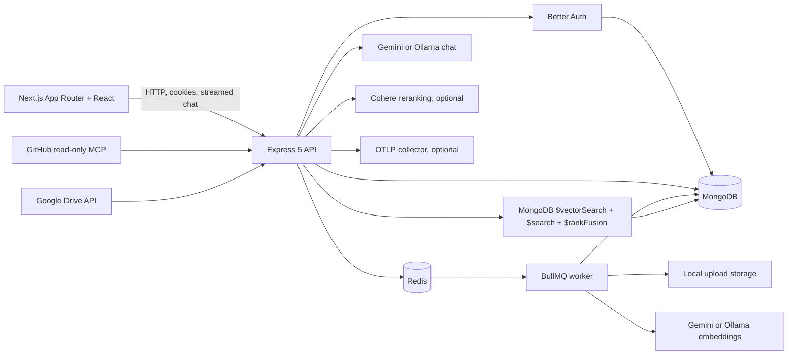

# OrgMind architecture

OrgMind is a TypeScript pnpm monorepo. The browser app calls an Express API; the API is the boundary for authentication, role checks, document access, chat, integrations, analytics, and audit events.

## Main flows

### Upload and ingestion

1. The authenticated user uploads a supported file to the API; workspace role and folder access are checked.
2. The API stores the original file locally, creates its MongoDB record, and enqueues an ingestion job in Redis through BullMQ.
3. The worker extracts bounded text, creates heading-aware overlapping chunks, and obtains embeddings from the configured provider.
4. MongoDB stores chunk text, metadata, ACL tokens, embedding profile, and vector. The document reports progress and becomes Ready when processing finishes.

### Chat and retrieval

1. The web app sends the question and conversation ID using the authenticated session.
2. The API applies prompt-injection and PII guardrails, creates a query embedding, and runs organization/ACL-filtered MongoDB vector and keyword search.
3. Rank fusion combines results; optional Cohere reranking or Agentic RAG can refine evidence selection within configured bounds.
4. The configured chat provider streams the answer and source citations. The API persists the response, observability metadata, feedback linkage, and audit outcome.

## Boundaries and operations

- `apps/web` owns the user interface; `apps/api` owns business logic and persistence; `packages/shared` owns API and stored-record schemas; `packages/evals` owns the golden evaluation fixtures and metrics.
- MongoDB is the source of truth for accounts, workspaces, documents, chunks, conversations, analytics, and audit records. Search indexes are version-controlled and bootstrapped with `pnpm db:search-indexes`.
- Redis supports ingestion jobs, rate-limit state, and semantic response cache. The app can run without optional OTLP export; setting `OTEL_EXPORTER_OTLP_ENDPOINT` enables it.
- Local files are stored under `.data/uploads` by default. Production object storage, scheduled connector sync, and multi-tenant operational hardening remain roadmap topics.

See the root README for local startup, configuration, and feature-level verification instructions.
